<p align="center">
  
</p>

<h1 align="center">deepseek-pet</h1>

<p align="center">
  <b>A tiny blue whale-girl who lives on your Mac desktop and reacts to your coding agents.</b><br>
  She thinks when Claude Code thinks, taps the keyboard when it works, sighs when it fails and cheers when it finishes.
</p>

<p align="center">
  
  
  
  
</p>

## Why you will want her

- **106 hand-animated transparent clips**: juggling, violin, hot pot, fireworks, a lion dance, a whale that appears out of nowhere.
- **She reacts to your agents.** Hooks for Claude Code, ZCode (Z.ai), Codex, Gemini, Qwen, Kimi, Copilot, Cursor and OpenCode drive her live.
- **You choose the animation for every event.** Map each hook event to a state, a specific clip, a random pool of clips, or nothing, from the menu-bar icon.
- **Click her** and she waves, bounces, giggles or gets tsundere. **Drag her** and she dangles.
- **Native and light**: Tauri v2, plain HTML/JS, no server, no database, no account. Sits in the menu bar, optional Dock icon.
- **English and Chinese** at the click of a button.

## Meet her

Her default animation is a slow turn-around (above). Everything below plays in the app; click through the menu-bar icon, then **Play animation**, to trigger any of the 106 clips yourself.

### Click her

<table>
<tr><td align="center"><br><sub>Energetic wave</sub></td><td align="center"><br><sub>Tsundere anger</sub></td><td align="center">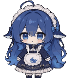<br><sub>Shy surprise</sub></td><td align="center"><br><sub>Happy bounce</sub></td></tr>
<tr><td align="center"><br><sub>Tickled giggling</sub></td></tr>
</table>

### Watching your agent work

<table>
<tr><td align="center"><br><sub>Writing code</sub></td><td align="center"><br><sub>Eating tokens</sub></td><td align="center"><br><sub>Thinking bubbles</sub></td><td align="center"><br><sub>Busy tapping</sub></td></tr>
<tr><td align="center"><br><sub>Sigh and sweat</sub></td><td align="center"><br><sub>Joyful celebration</sub></td></tr>
</table>

### Play and hobbies

<table>
<tr><td align="center"><br><sub>Juggling</sub></td><td align="center">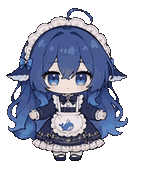<br><sub>Maid dance</sub></td><td align="center">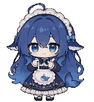<br><sub>Otaku dance</sub></td><td align="center"><br><sub>Violin</sub></td></tr>
<tr><td align="center"><br><sub>Flute</sub></td><td align="center"><br><sub>Rubik's cube</sub></td><td align="center"><br><sub>Petting a cat</sub></td><td align="center"><br><sub>Swinging</sub></td></tr>
</table>

### Festivals and seasons

<table>
<tr><td align="center"><br><sub>Fireworks</sub></td><td align="center"><br><sub>Snowman</sub></td><td align="center"><br><sub>Lion dance</sub></td><td align="center">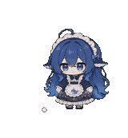<br><sub>Christmas tree</sub></td></tr>
<tr><td align="center">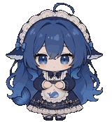<br><sub>Trick-or-treat</sub></td><td align="center">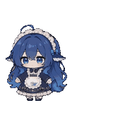<br><sub>Mid-Autumn</sub></td><td align="center">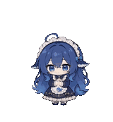<br><sub>Kite</sub></td></tr>
</table>

### Magic and animals

<table>
<tr><td align="center"><br><sub>Turning into a pigeon</sub></td><td align="center">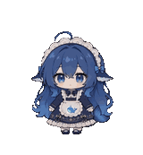<br><sub>A blue whale appears</sub></td><td align="center">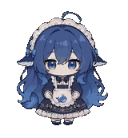<br><sub>Cute little ghost</sub></td><td align="center"><br><sub>Blowing bubbles</sub></td></tr>
<tr><td align="center">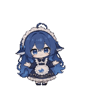<br><sub>Flowers from thin air</sub></td><td align="center">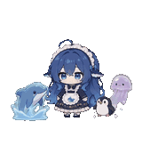<br><sub>Surrounded by animals</sub></td></tr>
</table>

### Meals and moods

<table>
<tr><td align="center"><br><sub>Hot pot</sub></td><td align="center"><br><sub>Dumplings</sub></td><td align="center"><br><sub>Watermelon</sub></td><td align="center"><br><sub>Ice cream melting</sub></td></tr>
<tr><td align="center"><br><sub>Yawning</sub></td><td align="center"><br><sub>Crab walk</sub></td><td align="center"><br><sub>Maid curtsy</sub></td></tr>
</table>

> These GIFs are rendered from the same frames the app plays. GitHub shows animated, transparent GIFs inline in a README, so no player or extra hosting is needed.

## Install

Homebrew (Apple Silicon). This repo is its own tap, so tap it by URL first:

```bash
brew tap teochenglim/deepseek-pet https://github.com/teochenglim/deepseek-pet
brew install --cask teochenglim/deepseek-pet/deepseek-pet
```

Or download `DeepseekPet_<version>_aarch64.dmg` from the [Releases page](https://github.com/teochenglim/deepseek-pet/releases) and drag the app to Applications. Builds are not notarized yet: first launch needs right-click, Open (the cask clears the quarantine flag for you).

Open the app once, then use the menu-bar icon, **Install hooks**, to wire up your agents. Restart the agent session afterwards.

## How it works

```
Claude Code / ZCode / Codex / Gemini / ...  --hook-->  pet-hook.sh  --localhost-->  desktop pet
                                                          |
                                         ~/.deepseek-pet/mapping.json (event -> state / clip / off)
```

| Agent event | Default reaction |
|---|---|
| Prompt submitted, thinking | thinking bubbles, or a random Work clip |
| Tool call | busy tapping, writing code, sorting files (random) |
| Needs permission or input | pacing and looking around |
| Error | head-down sigh |
| Task done | joyful celebration |
| Idle | breathing, humming, the slow turn-around |

Change any row from the menu-bar icon, **Map animations**.

## Hooks from the command line

```bash
./scripts/install-hooks.sh      # every supported agent found on this Mac
./scripts/uninstall-hooks.sh    # removes only our entries
```

Safe to run repeatedly. `--only claude` or `--only zai` limits it to one agent.

## Build from source

```bash
make setup      # npm ci
make run        # dev run
make build      # .app and .dmg
make check      # fmt, clippy, lint, tests, traceability
```

Docs: [RELEASE.md](RELEASE.md) (release log), [PRD.md](PRD.md), [AGENTS.md](AGENTS.md) (contributor guide).

## Credits

Code skeleton from [golitter/coding-agent-pet](https://github.com/golitter/coding-agent-pet); animations and character from [Bai-Cute/big-blue-fish-desktop-pet](https://github.com/Bai-Cute/big-blue-fish-desktop-pet) (Apache-2.0). See [NOTICE](NOTICE).
